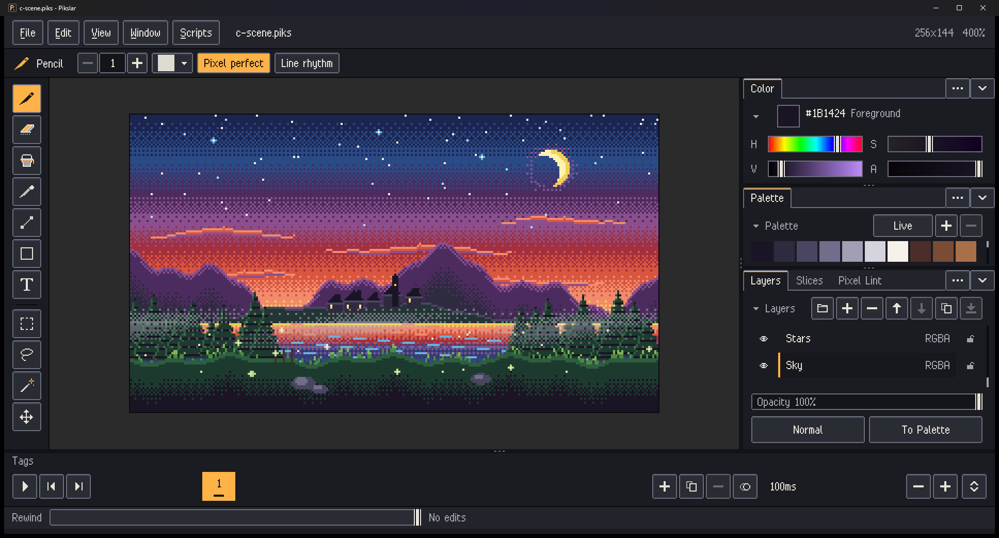
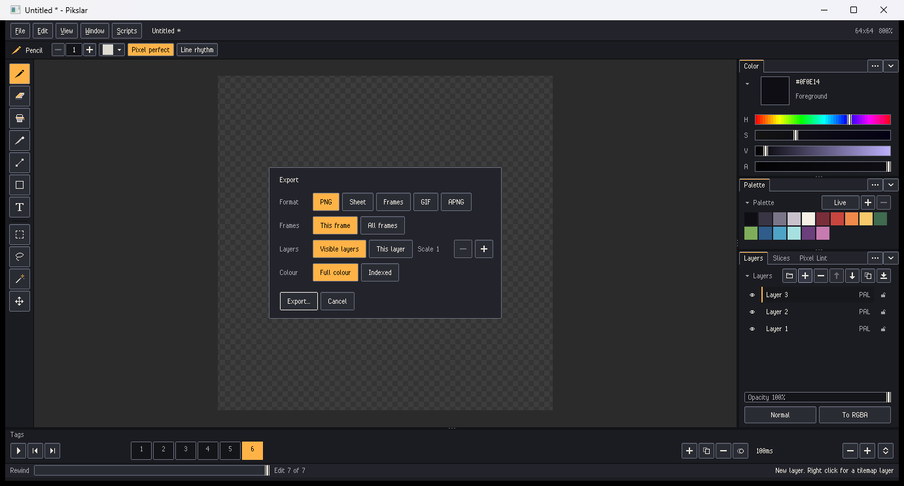
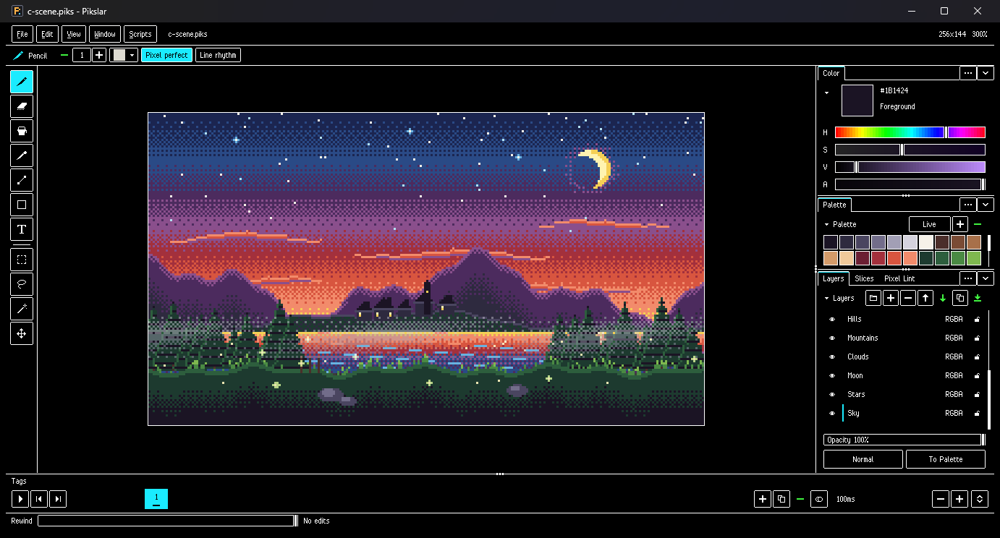

<p align="center">
  
</p>

<h1 align="center">Pikslar</h1>

<p align="center">
  A lightweight pixel-art editor and animation studio for Windows, written from scratch in Rust.
</p>

<p align="center">
  <a href="#status">Status: 0.9.0 beta</a> ·
  <a href="#build">Build</a> ·
  <a href="docs/release/README.txt">Using the beta</a> ·
  <a href="docs/shortcuts.md">Shortcuts</a> ·
  <a href="#licence">Licence</a>
</p>

<p align="center">
  
</p>

Pikslar is a native Win32 program for drawing and animating sprites. It is one small executable
with no installer, no runtime and no third-party libraries in its own code, and it is measured
against recorded performance limits on every change.

## What it does

- **Drawing.** Pencil, eraser, fill, line, rectangle, picker and text, with pixel-perfect strokes,
  Line Rhythm, brush sizes and custom brushes captured from a selection.
- **Layers.** Groups, opacity, nine blend modes, locking, merging, and reference layers for
  tracing that never reach an export.
- **Animation.** A timeline of every layer against every frame: linked cels, holds, tags, frame
  timing, position tweens with easing, onion skin and a true-size preview.
- **Selections.** Box, lasso and magic wand; move, flip and rotate the picked-up pixels.
- **Palettes.** Groups, sorting, Oklab ramps, lossless remaps; GIMP, JASC and hex palette files.
- **Tilemaps.** Tilesets, tilemap layers and automatic terrains, exported for the Tiled editor.
- **Export.** PNG, sprite sheets with JSON, sequences, GIF, APNG, indexed PNG, ICO and CUR, scaled
  by whole numbers, also from the separate `pikslar-cli` tool.
- **Safe saving and recovery.** Saving runs in the background and replaces the old file only after
  the new one has been read back; a recovery copy of unsaved work is kept while you draw.
- **Keyboard and contrast.** Every control is reachable from the keyboard, shortcuts can be
  changed, and the interface follows Windows high contrast and text size.

Experimental in this beta: read-only Aseprite import, scripting, plugins and Rewind (undo history
kept after closing).

<table>
  <tr>
    <td width="50%"></td>
    <td width="50%"></td>
  </tr>
  <tr>
    <td>Export: frames, sheets, sequences and animated files</td>
    <td>Windows high contrast, as Pikslar's test switch draws it</td>
  </tr>
</table>

## Status

**0.9.0 beta, the first Windows beta. There is no public release or download yet.** A small,
invited beta on Windows 11 is being prepared, followed by a first round of hands-on usability
sessions with artists.

| | |
|---|---|
| Windows 11 (64-bit) | Tested on one computer, by automation |
| Windows 10 1703 or later (64-bit) | Expected to run; not yet tested |
| Use by real people | Not yet: the first usability sessions have not taken place |
| Screen readers, pen tablets | Not supported |
| Code signing | Not signed; SmartScreen warns on first start |

### Recent changes

- **Interface refinement.** Status line and hints that fit at 150 % text and Large text; the
  four workspace layouts adapt to narrow windows and 2x scaling instead of clipping panels;
  timeline frame numbers up to four digits fit without overlapping.
- **Clearer controls.** Tooltips and keyboard-focus hints for icon-only buttons, including the
  panel and Export scale controls; the high-contrast default button is marked by more than
  colour; clearer labels, units and guidance in the New sprite and Export dialogs.
- **Tiles.** An empty Tiles panel now offers to add a tilemap layer directly.
- **Safety fixes.** Plugins load only if they were approved in Pikslar's own install review;
  before saving over a changed file on slow storage, Pikslar waits at most 5 seconds for its
  check and then asks, instead of holding the window.

### Measured

Measured on the development computer with the beta build: the executable is about 3 MB, its
window exists about 21 ms after it starts (median), input reaches the screen in about 3 ms
(median), and it uses no processor time when idle. These are test results from one Windows 11
computer, not guarantees. The full list of what is known to be missing or untested is in
[docs/release/KNOWN-ISSUES.txt](docs/release/KNOWN-ISSUES.txt).

## Build

Windows 10 or 11 (64-bit), Rust for the `x86_64-pc-windows-gnu` target, and a MinGW-w64 linker.

```powershell
cargo run --release -p pikslar
```

Open a file directly with `pikslar sprite.piks` or `pikslar image.png`. Release packages are built
reproducibly by `spikes/make-release.ps1`; see [docs/b1-packaging.md](docs/b1-packaging.md).

`cargo run --release -p pikslar-bench` runs the performance gate against
[perf/baseline.txt](perf/baseline.txt).

## Documentation

- [Using the beta](docs/release/README.txt): requirements, checking your copy, what Pikslar writes and where, the command line
- [Keyboard shortcuts and command-line options](docs/shortcuts.md)
- [Release notes](docs/release/RELEASE-NOTES.txt) and [known issues](docs/release/KNOWN-ISSUES.txt)
- [Export and the command-line tool](docs/export-and-cli.md), [scripting](docs/scripting-api.md), [plugins](docs/plugins.md)
- [All documentation](docs/README.md)

## Layout

| Crate | Purpose |
|---|---|
| `pikslar-core` | Documents, tools, undo history, selections, animation, tilemaps |
| `pikslar-render` | Compositing and the zoomed display |
| `pikslar-format` | Project files, PNG and compression |
| `pikslar-export` | GIF, APNG, sheets and the other export formats |
| `pikslar-platform` | The Win32 window, input, dialogs and clipboard |
| `pikslar-ui` | Font, icons, widgets and the Lightbox theme |
| `pikslar` | The editor |
| `pikslar-cli` | The command-line tool |
| `pikslar-script`, `pikslar-api`, `pikslar-bind` | The scripting language, its API and running scripts on a document |
| `pikslar-plugin`, `pikslar-json` | Plugin manifests and review; a small JSON reader and writer |
| `pikslar-rewind` | Undo history kept between sessions |
| `pikslar-res` | Windows resources (icon, version, manifest), at build time only |
| `pikslar-bench`, `pikslar-safety` | The performance gate; file-corpus and malformed-input checks |

## Licence

Pikslar is source-available under the [PolyForm Noncommercial License 1.0.0](LICENSE.md): you may use,
copy, change and share it for any noncommercial purpose. Commercial use needs separate permission.
Third-party components in the program files are listed with their own licences in
[docs/release/THIRD-PARTY-NOTICES.txt](docs/release/THIRD-PARTY-NOTICES.txt).
