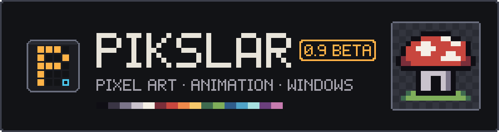
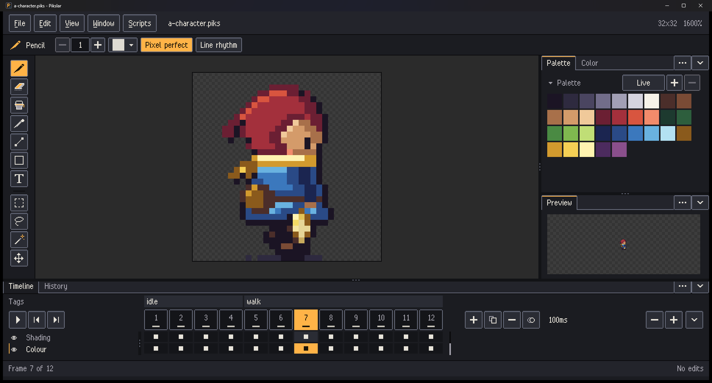
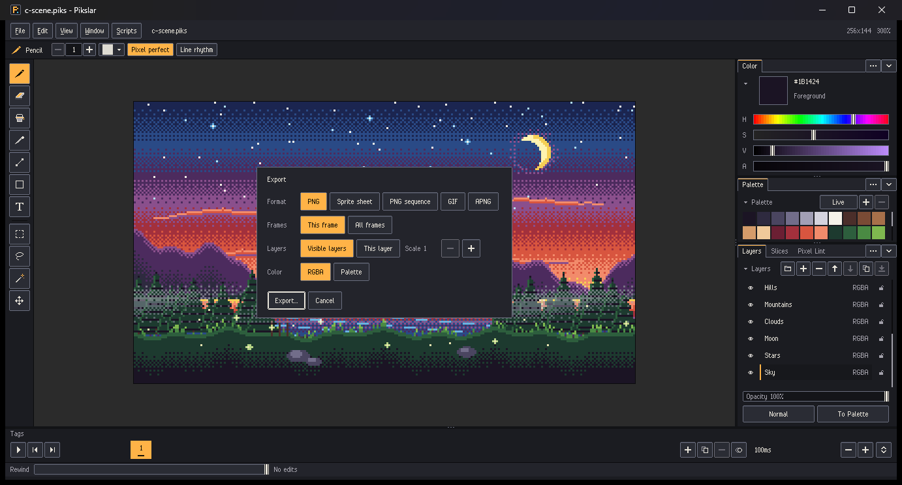

<p align="center">
  
</p>

<p align="center">
  <b>A lightweight pixel-art editor and animation studio for Windows, written from scratch in Rust.</b><br>
  One small executable. No installer, no runtime, no third-party libraries in its own code.
</p>

<p align="center">
  
  
  
  
</p>

<p align="center">
  <a href="#features">Features</a> ·
  <a href="#build-and-run">Build</a> ·
  <a href="docs/release/README.txt">Using the beta</a> ·
  <a href="docs/shortcuts.md">Shortcuts</a> ·
  <a href="https://sepinz.github.io/pikslar/">Website</a>
</p>

<br>

<p align="center">
  
</p>

<p align="center">
  <b>~3 MB</b> one executable &nbsp;·&nbsp; <b>~21 ms</b> to a window &nbsp;·&nbsp;
  <b>~3 ms</b> input to screen &nbsp;·&nbsp; <b>0 %</b> CPU when idle<br>
  <sub>Medians measured on one Windows 11 development computer with the beta build. Test results, not guarantees.</sub>
</p>

<p align="center"></p>

## Features

<table>
  <tr>
    <td width="50%" valign="top">
      <h4>Draw</h4>
      Pencil, eraser, fill, line, rectangle, picker and text, with pixel-perfect strokes, Line
      Rhythm, brush sizes and custom brushes captured from a selection.
    </td>
    <td width="50%" valign="top">
      <h4>Animate</h4>
      A timeline of every layer against every frame: linked cels, holds, tags, frame timing,
      position tweens with easing, onion skin and a true-size preview.
    </td>
  </tr>
  <tr>
    <td valign="top">
      <h4>Layers and selections</h4>
      Groups, opacity, nine blend modes, locking, merging and reference layers. Box, lasso and
      magic wand; move, flip and rotate the picked-up pixels.
    </td>
    <td valign="top">
      <h4>Palettes and tilemaps</h4>
      Palette groups, sorting, Oklab ramps and lossless remaps; GIMP, JASC and hex files.
      Tilesets, tilemap layers and automatic terrains, exported for Tiled.
    </td>
  </tr>
  <tr>
    <td valign="top">
      <h4>Export</h4>
      PNG, sprite sheets with JSON, sequences, GIF, APNG, indexed PNG, ICO and CUR, scaled by
      whole numbers, also from the separate command-line tool.
    </td>
    <td valign="top">
      <h4>Safe by default</h4>
      Saving runs in the background and replaces the old file only after the new one has been
      read back. A recovery copy of unsaved work is kept while you draw.
    </td>
  </tr>
</table>

Every control is reachable from the keyboard, shortcuts can be changed, and the interface follows
Windows high contrast and text size. Experimental in this beta: read-only Aseprite import,
scripting, plugins and Rewind (undo history kept after closing).

<p align="center">
  
  <sub>Animate: tagged idle and walk cycles on the timeline, with a live preview</sub>
</p>

<table>
  <tr>
    <td width="50%"></td>
    <td width="50%"></td>
  </tr>
  <tr>
    <td align="center"><sub>Export: frames, sheets, sequences and animated files</sub></td>
    <td align="center"><sub>Windows high contrast</sub></td>
  </tr>
</table>

## Status

> [!NOTE]
> **0.9.0 beta, the first Windows beta.** There is no public release or download yet. A small,
> invited beta on Windows 11 is being prepared, followed by a first round of hands-on usability
> sessions with artists.

| Area | Status |
|---|---|
| Windows 11 (64-bit) | Tested on one computer, by automation |
| Windows 10 1703 or later (64-bit) | Expected to run; not yet tested |
| Use by real people | Not yet: the first usability sessions have not taken place |
| Screen readers, pen tablets | Not supported |
| Code signing | Not signed; SmartScreen warns on first start |

Everything known to be missing or untested is listed in
[KNOWN-ISSUES.txt](docs/release/KNOWN-ISSUES.txt).

<details>
<summary><b>Recent changes</b></summary>
<br>

- **Interface refinement.** Status line and hints that fit at 150 % text and Large text; the
  four workspace layouts adapt to narrow windows and 2x scaling instead of clipping panels;
  timeline frame numbers up to four digits fit without overlapping.
- **Clearer controls.** Tooltips and keyboard-focus hints for icon-only buttons, including the
  panel and Export scale controls; the high-contrast default button is marked by more than
  colour; clearer labels, units and guidance in the New sprite and Export dialogs.
- **Tiles.** An empty Tiles panel now offers to add a tilemap layer directly.
- **Safety fixes.** Plugins load only if they were approved in Pikslar's own install review;
  before saving over a changed file on slow storage, Pikslar waits at most 5 seconds for its
  check and then asks, instead of holding the window.

</details>

## Build and run

You need Windows 10 or 11 (64-bit), Rust for the `x86_64-pc-windows-gnu` target, and a
MinGW-w64 linker.

```powershell
cargo run --release -p pikslar
```

Open a file directly with `pikslar sprite.piks` or `pikslar image.png`.

<details>
<summary><b>Release packages and the performance gate</b></summary>
<br>

Release packages are built reproducibly by `spikes/make-release.ps1`; see
[docs/b1-packaging.md](docs/b1-packaging.md).

`cargo run --release -p pikslar-bench` runs the performance gate against
[perf/baseline.txt](perf/baseline.txt).

</details>

<details>
<summary><b>Project layout</b></summary>
<br>

| Crate | Purpose |
|---|---|
| `pikslar` | The editor |
| `pikslar-core` | Documents, tools, undo history, selections, animation, tilemaps |
| `pikslar-render` | Compositing and the zoomed display |
| `pikslar-format` | Project files, PNG and compression |
| `pikslar-export` | GIF, APNG, sheets and the other export formats |
| `pikslar-platform` | The Win32 window, input, dialogs and clipboard |
| `pikslar-ui` | Font, icons, widgets and the Lightbox theme |
| `pikslar-cli` | The command-line tool |
| `pikslar-script`, `pikslar-api`, `pikslar-bind` | The scripting language, its API and running scripts on a document |
| `pikslar-plugin`, `pikslar-json` | Plugin manifests and review; a small JSON reader and writer |
| `pikslar-rewind` | Undo history kept between sessions |
| `pikslar-res` | Windows resources (icon, version, manifest), at build time only |
| `pikslar-bench`, `pikslar-safety` | The performance gate; file-corpus and malformed-input checks |

</details>

## Documentation

| Document | What it covers |
|---|---|
| [Using the beta](docs/release/README.txt) | Requirements, checking your copy, what Pikslar writes and where |
| [Keyboard shortcuts](docs/shortcuts.md) | Every shortcut and command-line option |
| [Release notes](docs/release/RELEASE-NOTES.txt) · [Known issues](docs/release/KNOWN-ISSUES.txt) | What is in the beta and what is not |
| [Export and CLI](docs/export-and-cli.md) · [Scripting](docs/scripting-api.md) · [Plugins](docs/plugins.md) | Going further |
| [All documentation](docs/README.md) | The full index |

## Licence

Pikslar is source-available under the [PolyForm Noncommercial License 1.0.0](LICENSE.md): you
may use, copy, change and share it for any noncommercial purpose. Commercial use needs separate
permission. Third-party components in the program files are listed with their own licences in
[THIRD-PARTY-NOTICES.txt](docs/release/THIRD-PARTY-NOTICES.txt).
